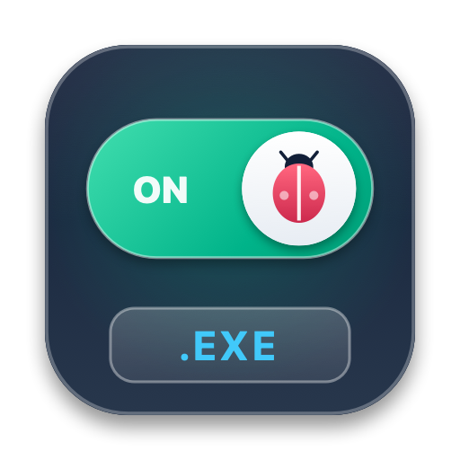

<p align="center">
  
</p>

<h1 align="center">Bug On EXE</h1>

<p align="center">
  <em>Seamlessly run interactive Adobe Flash (.swf, Flash Projector .exe) and lightweight portable Windows applications on macOS with a single double-click.</em><br/>
  <strong>Mở và chạy mượt mà file Flash (.swf, .exe) cùng ứng dụng Windows portable trên macOS bằng một cú double-click.</strong>
</p>

<p align="center">
  <a href="https://github.com/stark/bug-on-mac-exe/releases"></a>
  
  
  <a href="LICENSE"></a>
</p>

<p align="center">
  <strong>Language:</strong> <a href="#-english">🇺🇸 English</a> | <a href="#-tiếng-việt">🇻🇳 Tiếng Việt</a>
</p>

---

## 🇺🇸 English

### 🐞 The Story Behind "Bug On EXE" & Vibe Coding with Gemini

**Bug On EXE** was brought to life through the creative process of **Vibe coding with Google Gemini**. The project embraces the harmony between human intent and AI agility—transforming an ambitious idea into a production-grade, highly polished macOS native utility with modern aesthetics and robust engineering.

The name carries a witty double meaning:
- In Vietnamese phonetics, **"Bug On"** sounds identical to **"Bất Ổn"** (meaning *turbulent*, *chaotic*, or *sketchy*). Opening and running Windows `.exe` binaries directly on a Mac has historically felt like a chaotic and "bất ổn" experience.
- In software terminology, it represents hunting **bugs** while flipping the switch **ON**—delivering immediate execution so seamlessly that Windows `.exe` files behave like first-class macOS citizens.

---

### ⚙️ Dual-Engine Architecture: How It Works

**Bug On EXE** implements an intelligent two-tier execution pipeline that automatically routes incoming files to the optimal execution engine without requiring any user intervention:

```
                  ┌───────────────────────────────┐
                  │   User double-clicks .exe    │
                  └───────────────┬───────────────┘
                                  │
                                  ▼
                ┌───────────────────────────────────┐
                │   PE Header & Signature Scanner   │
                └─────────┬───────────────────────┬─┘
                          │                       │
      Embedded Flash/SWF  │                       │ Non-Flash / Portable EXE
       Signature Detected │                       │
                          ▼                       ▼
            ┌───────────────────────────┐   ┌───────────────────────────┐
            │   Engine 1: Flash Engine  │   │    Engine 2: Wine Engine  │
            ├───────────────────────────┤   ├───────────────────────────┤
            │ • Instant payload extract │   │ • 7-Zip SFX unpacker      │
            │ • Auto-generate FlashTrust│   │ • Wine 9+ 64-bit runtime  │
            │ • Direct Projector launch │   │ • Persistent sessions     │
            └───────────────────────────┘   └───────────────────────────┘
```

1. **Engine 1 — Native Flash Projector (Sub-second Launch):**
   - **Deep Payload Extraction:** Inspects PE32 binaries for embedded ActionScript 2 / 3 and Adobe Flex payloads (matching the classic `0xFA123456` Flash Projector trailer as well as nested resource boundaries).
   - **Zero Sandbox Friction:** Automatically generates and registers security trust entries in `FlashPlayerTrust`, eliminating legacy Flash security prompts and linking companion media/XML assets located in the same directory.
   - **Native 64-bit Projector:** Launches directly via a bundled 64-bit Adobe Flash Player Projector runtime on macOS.

2. **Engine 2 — Portable Windows Executable & 7-Zip SFX Engine:**
   - **Portable Archive Extraction:** Detects and unpacks 7-Zip Self-Extracting (`.sfx`) executables into sandboxed temporary working spaces.
   - **Automated Wine Dispatch:** When an `.exe` is not a Flash Projector, the app dynamically routes execution to Wine runtime management with persistent session state, enabling lightweight Windows tools and legacy utilities to run without complex VM setups.

---

### ✨ Key Features

- **Double-Click Association:** One-click registration as the default macOS handler for both `.exe` and `.swf` files via Finder.
- **macOS 26+ Liquid Glass Interface:** Built with SwiftUI utilizing native `.ultraThinMaterial`, translucent glass cards, specular rim highlights, and dynamic system vibrancy.
- **Smooth Backward Fallback:** Automatically detects the host OS version; on macOS < 26, it gracefully falls back to a clean, lightweight AppKit view for guaranteed stability.
- **Library & Recents Manager:** Manage frequently opened utilities, pin important apps, search on the fly, or drag-and-drop new files into the launcher dropzone.
- **Adaptive Mascot App Icon:** Brand icon featuring the cute orange robot bug riding an `.EXE` rocket with exhaust flames. Built with Xcode 26 Asset Catalog to dynamically adapt between Light mode (ceramic off-white) and Dark mode (obsidian metallic).
- **Instant Bilingual Switcher:** Complete runtime interface localization in English and Vietnamese.

---

### 🧱 Standardized Tech Stack

| Layer | Technologies & Standards | Purpose |
| :--- | :--- | :--- |
| **Language & Toolchain** | Swift 5.10+, Clang, Xcode Command Line Tools | Fast native compiled performance without heavy dependencies |
| **User Interface** | SwiftUI, AppKit, `NSHostingController` | Liquid Glassmorphic card grid on macOS 26+, classic fallback on macOS < 26 |
| **Asset & Icon Pipeline** | WebKit CoreGraphics, `actool`, `iconutil` | High-fidelity vector SVG rasterization with full filter and dual-appearance support |
| **Flash Runtime** | Adobe Flash Player Projector 32 (Mach-O 64-bit `x86_64`) | Direct, sandbox-free Flash execution |
| **Windows Emulation** | Wine 9.0+, 7-Zip Portable SFX Extractor | Compatibility layer for general portable Windows `.exe` files |
| **Packaging & Release** | Bash, `hdiutil` (UDZO DMG), ad-hoc codesign | Self-contained, zero-configuration `.dmg` and `.zip` distribution |

---

### 🚀 Installation & Quick Start

#### Option 1: Download Pre-built Release (Recommended)

1. Navigate to the [**Releases**](../../releases) section on GitHub.
2. Download the latest release:
   - **`Bug-On-EXE-macOS.dmg`** *(Recommended)*: Open the DMG and drag **Bug On EXE.app** into your **Applications** folder.
   - **`Bug-On-EXE-macOS.zip`**: Extract and copy **Bug On EXE.app** to `/Applications`.
3. **Bypassing macOS Gatekeeper (First Launch):**  
   Because this application is distributed independently without a paid Apple Developer certificate, macOS Gatekeeper may display an *"unidentified developer"* notice. To clear quarantine, simply run this one-line command in your **Terminal**:
   ```bash
   xattr -cr "/Applications/Bug On EXE.app"
   ```
   *(Alternatively, right-click the app in Finder and select **Open**).*
4. Launch **Bug On EXE**, click **Set as Default**, and enjoy running your `.exe` and `.swf` files natively!

---

### 🛠️ Building from Source

**Requirements:**
- macOS 13.0 or later (Intel `x86_64` or Apple Silicon via Rosetta 2)
- Xcode Command Line Tools or Xcode 16+ (`swiftc`, `actool`, `iconutil`)

```bash
# Clone the repository
git clone https://github.com/stark/bug-on-mac-exe.git
cd bug-on-mac-exe

# 1. Build and install directly into /Applications/Bug On EXE.app
bash scripts/build_app.sh

# 2. Package release DMG and ZIP into dist/
bash scripts/package_release.sh
```

---

## 🇻🇳 Tiếng Việt

### 🐞 Câu chuyện thương hiệu "Bug On EXE" & Vibe Coding cùng Gemini

**Bug On EXE** được kiến tạo thông qua trải nghiệm **Vibe coding cùng Google Gemini**. Dự án là sự kết tinh giữa ý tưởng người dùng và khả năng hiện thực hóa thần tốc của AI—biến một mong muốn tưởng chừng phức tạp thành tiện ích native macOS chuẩn mực, tinh tế và hoạt động ổn định.

Tên gọi **"Bug On EXE"** mang một thông điệp chơi chữ thú vị:
- Trong phát âm tiếng Việt, **"Bug On"** đọc hoàn toàn đồng âm với **"Bất Ổn"**. Việc một chiếc máy Mac mở và chạy file `.exe` của Windows vốn luôn đem lại cảm giác đầy *"bất ổn"*, tiềm ẩn lỗi và khó chịu.
- Trong thuật ngữ công nghệ, đó là hành trình săn lùng **bug** kết hợp với công tắc đang bật **ON**—mang lại trải nghiệm mượt mà, biến các tập tin Windows `.exe` trở thành những ứng dụng hoạt động tự nhiên như phần mềm gốc trên macOS.

---

### ⚙️ Kiến trúc Hai Tầng (Dual-Engine) & Cơ chế hoạt động

**Bug On EXE** sở hữu bộ điều phối thông minh tự động phân loại tập tin và kích hoạt nhân xử lý tối ưu tương ứng mà người dùng không cần phải can thiệp thủ công:

```
                  ┌───────────────────────────────┐
                  │    Người dùng click mở .exe   │
                  └───────────────┬───────────────┘
                                  │
                                  ▼
                ┌───────────────────────────────────┐
                │   Quét Header PE & Chữ ký nhúng   │
                └─────────┬───────────────────────┬─┘
                          │                       │
           Phát hiện chữ  │                       │ File EXE thông thường /
           ký Flash/SWF   │                       │ Gói nén tự bung (SFX)
                          ▼                       ▼
            ┌───────────────────────────┐   ┌───────────────────────────┐
            │   Tầng 1: Flash Engine    │   │     Tầng 2: Wine Engine   │
            ├───────────────────────────┤   ├───────────────────────────┤
            │ • Bóc tách SWF tức thì    │   │ • Trích xuất 7-Zip SFX    │
            │ • Cấu hình FlashTrust     │   │ • Nhân Wine 9+ (64-bit)   │
            │ • Chạy Flash Projector    │   │ • Quản lý session bền vững│
            └───────────────────────────┘   └───────────────────────────┘
```

1. **Tầng 1 — Nhân Flash Projector Native (Khởi chạy tức thì < 1 giây):**
   - **Bóc tách sâu Payload:** Quét cấu trúc PE32 tìm các phân đoạn nhúng ActionScript 2 / 3 và Adobe Flex (nhận diện chữ ký gốc `0xFA123456` của Flash Projector cũng như các vùng tài nguyên SWF ẩn).
   - **Xóa bỏ rào cản Sandbox:** Tự động tạo và đăng ký đường dẫn tin cậy trong `FlashPlayerTrust`, triệt tiêu hoàn toàn các hộp thoại cảnh báo bảo mật cũ của Flash; đồng thời tự động liên kết các file media/XML nằm cùng thư mục với file `.exe`.
   - **Nhân Projector 64-bit:** Khởi chạy trực tiếp thông qua Adobe Flash Player Projector 32 (Mach-O 64-bit) tích hợp sẵn bên trong app.

2. **Tầng 2 — Nhân Windows Portable & Bộ giải nén 7-Zip SFX:**
   - **Trích xuất gói nén Portable:** Tự động nhận diện và bóc tách các file thực thi dạng 7-Zip Self-Extracting (`.sfx`) vào không gian làm việc tạm an toàn.
   - **Điều phối Wine tự động:** Với các file `.exe` không nhúng Flash, ứng dụng tự động điều phối qua Wine runtime với cơ chế quản lý session bền vững, giúp mở các tiện ích portable Windows nhẹ mà không cần dựng máy ảo cồng kềnh.

---

### ✨ Tính năng nổi bật

- **Mở trực tiếp qua Double-Click:** Tích hợp sâu vào Finder, đăng ký làm ứng dụng mặc định mở file `.exe` và `.swf` chỉ với 1 cú click (`Set as Default`).
- **Giao diện macOS 26+ Liquid Glass:** Dựng bằng SwiftUI với hiệu ứng kính mờ `.ultraThinMaterial`, các thẻ card bóng kính mờ, viền phản quang specular rim và độ rung màu tự nhiên của hệ thống.
- **Cơ chế Fallback mượt mà trên macOS cũ:** Tự động nhận diện phiên bản hệ điều hành; trên macOS < 26 sẽ tự động chuyển về view AppKit truyền thống gọn gàng, đảm bảo tính ổn định tuyệt đối.
- **Quản lý Thư viện & Lịch sử mở:** Dễ dàng quản lý các tiện ích thường dùng, ghim ứng dụng quan trọng (`Pinned`), tìm kiếm tức thì hoặc kéo-thả file vào vùng dropzone.
- **Icon thích ứng sáng/tối (Adaptive Mascot Icon):** Biểu tượng chú bọ robot cam cưỡi tên lửa `.EXE` có luồng lửa phản lực. Sử dụng Asset Catalog biên dịch qua Xcode 26 để tự động thích ứng giữa Light Mode (nền trắng gốm bạc) và Dark Mode (nền đen than obsidian).
- **Chuyển đổi song ngữ tức thì:** Hỗ trợ đầy đủ ngôn ngữ hiển thị tiếng Anh và tiếng Việt lúc chạy ứng dụng.

---

### 🧱 Bảng Tech Stack Chuẩn Hoá

| Tầng công nghệ | Công nghệ & Chuẩn áp dụng | Vai trò trong dự án |
| :--- | :--- | :--- |
| **Ngôn ngữ & Trình biên dịch** | Swift 5.10+, Clang, Xcode Command Line Tools | Hiệu năng native tối đa, biên dịch trực tiếp, không phụ thuộc thư viện ngoài |
| **Giao diện người dùng** | SwiftUI, AppKit, `NSHostingController` | Lưới thẻ kính mờ Liquid Glass trên macOS 26+, giao diện fallback trên macOS < 26 |
| **Quy trình Icon & Đồ họa** | WebKit CoreGraphics, `actool`, `iconutil` | Kết xuất vector SVG giữ nguyên bộ lọc neon/glow, Asset Catalog thích ứng giao diện |
| **Nhân chạy Flash** | Adobe Flash Player Projector 32 (Mach-O 64-bit `x86_64`) | Môi trường thực thi Flash độc lập, không bị hạn chế sandbox |
| **Tương thích Windows** | Wine 9.0+, Trình bóc tách 7-Zip Portable SFX | Lớp tương thích mở các file `.exe` Windows portable độc lập |
| **Đóng gói & Phân phối** | Bash, `hdiutil` (UDZO DMG), ad-hoc codesign | Bộ đóng gói tự động tạo file cài đặt `.dmg` và `.zip` sẵn sàng sử dụng |

---

### 🚀 Hướng dẫn Cài đặt & Sử dụng

#### Cách 1: Tải bản đóng gói sẵn (Khuyên dùng)

1. Truy cập mục [**Releases**](../../releases) ở cột bên phải repository này.
2. Tải về phiên bản mới nhất:
   - **`Bug-On-EXE-macOS.dmg`** *(Khuyên dùng)*: Mở file DMG và kéo biểu tượng **Bug On EXE.app** vào thư mục **Applications**.
   - **`Bug-On-EXE-macOS.zip`**: Giải nén và chép file **Bug On EXE.app** vào thư mục `/Applications`.
3. **Vượt qua cảnh báo Gatekeeper (Lần mở đầu tiên):**  
   Vì ứng dụng được phân phối tự do độc lập không thông qua chứng chỉ trả phí của Apple, macOS có thể hiển thị thông báo *"unidentified developer"*. Để mở khóa, bạn chỉ cần mở **Terminal** và chạy lệnh sau:
   ```bash
   xattr -cr "/Applications/Bug On EXE.app"
   ```
   *(Hoặc chuột phải vào ứng dụng trong Finder và chọn **Open**).*
4. Mở **Bug On EXE**, bấm nút **Đặt làm mặc định (Set as Default)**, và từ giờ bạn có thể double-click mở bất kỳ file `.exe` hay `.swf` nào một cách hoàn toàn tự nhiên!

---

### 🛠️ Tự biên dịch từ mã nguồn (Build from Source)

**Yêu cầu hệ thống:**
- macOS 13.0 trở lên (máy Mac Intel `x86_64` hoặc Apple Silicon chạy qua Rosetta 2)
- Xcode Command Line Tools hoặc Xcode 16+ (`swiftc`, `actool`, `iconutil`)

```bash
# Clone repository về máy
git clone https://github.com/stark/bug-on-mac-exe.git
cd bug-on-mac-exe

# 1. Biên dịch và cài đặt trực tiếp vào /Applications/Bug On EXE.app
bash scripts/build_app.sh

# 2. Đóng gói bộ cài đặt DMG và ZIP ra thư mục dist/
bash scripts/package_release.sh
```
