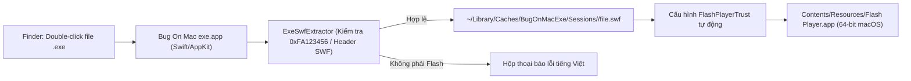

# Thiết kế Ứng dụng "Bug On Mac exe" cho macOS (Giai đoạn 1)

## 1. Mục đích & Lý do (Intent and Why)
Người dùng đang sử dụng máy Mac chạy **macOS 26.7.2 (chip Intel i5 `x86_64`)** và cần chạy các bài luyện tập/thi thử chứng chỉ tin học **IC3 GS6** (ví dụ: [GS6_LV3_TESTING_01_(2526GM).exe](file:///Users/stark/Documents/IC3/GS6%20Level%203/GS6_LV3_TESTING_01_%282526GM%29.exe), [GS6_LV3_TRAINING_01_(2526GM).exe](file:///Users/stark/Documents/IC3/GS6%20Level%203/GS6_LV3_TRAINING_01_%282526GM%29.exe) trong `/Users/stark/Documents/IC3/`). Các file này được đóng gói dưới dạng file thực thi Windows 32-bit (`.exe` dạng portable nhẹ ~5,4 MB), bên trong nhúng nội dung **Adobe Flash (SWF v9, viết bằng Adobe Flex / ActionScript 3)** nặng ~1,2 MB.

Trên macOS hiện đại, hệ điều hành không mở trực tiếp được file `.exe` và cũng đã ngừng hỗ trợ ứng dụng 32-bit. Người dùng muốn có một ứng dụng macOS gọn nhẹ, cho phép **chọn làm ứng dụng mặc định (Default App) cho đuôi `.exe`** để mỗi khi double-click vào các file `.exe` Flash trong Finder, bài thi sẽ mở lên ngay lập tức như một ứng dụng thông thường trên Mac.

---

## 2. Mục tiêu, Phi mục tiêu & Điều cần tránh (Goals, Non-Goals, Anti-Goals)

### Mục tiêu (Goals - Giai đoạn 1)
1. **Mở trực tiếp khi Double-click (`.exe` & `.swf`):** Đăng ký `Info.plist` (`CFBundleDocumentTypes`) nhận diện định dạng `.exe` (`com.microsoft.windows-executable`, `public.executable`) và `.swf` với macOS Finder.
2. **Đặt làm App mặc định 1 chạm:** Cung cấp nút bấm ngay trên giao diện chính (sử dụng CoreServices `LSSetDefaultRoleHandlerForContentType`) để gán ứng dụng làm trình mở mặc định cho mọi file `.exe` mà không cần tìm sâu trong Finder Get Info.
3. **Bóc tách `.swf` tức thì & Chính xác:**
   - **Fast-path:** Đọc 8 byte cuối của file `.exe` để kiểm tra chữ ký Adobe Flash Projector chuẩn (`0xFA123456` ở dạng little-endian `56 34 12 FA`) và độ dài khối SWF (`uint32`), sau đó xác thực header `FWS` / `CWS` / `ZWS`.
   - **Fallback-path:** Nếu file `.exe` có chữ ký số hoặc dữ liệu đệm ở cuối làm lệch 8 byte cuối, quét tìm header `CWS`/`FWS`/`ZWS` hợp lệ bên trong thân file PE32 để trích xuất đúng khối SWF.
4. **Chạy gốc 100% tương thích ActionScript 3 / Adobe Flex:** Đóng gói sẵn nhân **Adobe Flash Player Projector 32 (bản 64-bit `x86_64` gốc cho macOS)** bên trong `Contents/Resources/Flash Player.app` để chạy file `.swf` đã bóc tách với độ tương thích tuyệt đối (âm thanh, kéo-thả, chấm điểm trong bài thi IC3 GS6).
5. **Tự động cấu hình quyền bảo mật Flash (FlashPlayerTrust) & Tài nguyên đi kèm:**
   - Tự động ghi cấu hình `FlashPlayerTrust` tại `~/Library/Preferences/Macromedia/Flash Player/#Security/FlashPlayerTrust/BugOnMacExe.cfg` để bài thi Adobe Flex không bao giờ bị chặn bởi hộp thoại bảo mật sandbox của Flash.
   - Khi trích xuất `.swf` vào thư mục tạm theo phiên chạy, tự động tạo symlink các file/thư mục cùng cấp với file `.exe` gốc sang thư mục chạy tạm để nếu có bài thi nạp thêm dữ liệu ngoài (XML, âm thanh rời) thì vẫn đọc được bình thường.
6. **Cửa sổ Quản lý & Mở nhanh (Launcher Window):** Khi mở ứng dụng trực tiếp từ `/Applications` hoặc Dock:
   - Hiển thị danh sách các bài tập trong `/Users/stark/Documents/IC3` và danh sách các file `.exe` mở gần đây để bấm chạy nhanh 1 click.
   - Hỗ trợ kéo-thả (Drag & Drop) file `.exe` vào cửa sổ hoặc chọn qua hộp thoại "Mở file...".
   - Hiển thị thông báo tiếng Việt rõ ràng nếu người dùng mở một file `.exe` không chứa nội dung Adobe Flash.

### Phi mục tiêu (Non-Goals - Giai đoạn 1)
- Chạy các phần mềm `.exe` Windows thông thường không phải Adobe Flash (sẽ được mở rộng ở Giai đoạn 2 bằng cách nối thêm tầng Wine `wow64` vào nhánh xử lý file `.exe` không có chữ ký Flash).
- Chỉnh sửa hoặc biên dịch ngược nội dung bài thi `.swf`.

### Điều cần tránh (Anti-Goals)
- **Không đóng gói Wine nặng hàng trăm MB ở Giai đoạn 1:** Giai đoạn đầu chỉ phục vụ các file Flash `.exe` nhẹ (~5 MB), việc bắt người dùng tải/khởi tạo môi trường Wine ~1 GB là cồng kềnh không cần thiết.
- **Không dùng trình giả lập chưa hoàn thiện AS3/Flex làm nhân chính:** Tránh dùng Ruffle làm nhân mặc định vì bộ đề IC3 GS6 dùng Adobe Flex (AS3) dễ bị liệt nút hoặc lỗi bố cục trên Ruffle.
- **Không bắt người dùng thao tác qua Terminal:** Mọi thao tác từ đặt app mặc định đến mở file đều phải qua giao diện đồ họa macOS chuẩn.

---

## 3. Ràng buộc kỹ thuật (Constraints)
- **Hệ điều hành & Phần cứng:** macOS 26.7.2, kiến trúc `x86_64` (Intel Core i5).
- **Công cụ biên dịch:** Máy đã có sẵn `/usr/bin/swiftc`, `/usr/bin/clang`, `/usr/local/bin/python3` (Command Line Tools), không phụ thuộc vào việc phải mở Xcode IDE thủ công.
- **Chữ ký ứng dụng & Gatekeeper:** Cả `Bug On Mac exe.app` và nhân `Flash Player.app` nhúng bên trong phải được gỡ cờ cách ly (`xattr -cr`) và ký ad-hoc (`codesign --force --deep --sign -`) để macOS 26 không chặn khi double-click.
- **Vị trí lưu trữ dự án:** Mã nguồn đặt tại `/Users/stark/Library/Application Support/AgentProfiles/antigravity/desktop/pixel11series/home/.gemini/antigravity/scratch/bug-on-mac-exe` và bản `.app` hoàn chỉnh được cài vào `/Applications/Bug On Mac exe.app`.

---

## 4. Các hướng tiếp cận đã cân nhắc (Approaches)

| Hướng | Mô tả | Đánh đổi (Trade-offs) | Quyết định |
| :--- | :--- | :--- | :--- |
| **Hướng 1: Native Swift App + Nhúng Adobe Flash Player Projector 32 (64-bit macOS)** | App Swift nhận sự kiện mở file `.exe` từ Finder, tách nhanh payload `.swf` qua chữ ký `0xFA123456`, tự cấu hình FlashPlayerTrust và khởi chạy bằng nhân Flash Player Projector 64-bit chính chủ của macOS nhúng trong `.app`. | **Ưu:** Nhẹ (~20 MB), mở tức thì, tương thích 100% với bài thi IC3 GS6 viết bằng Adobe Flex (AS3). **Nhược:** Giai đoạn 1 chỉ mở được `.exe` dạng Flash (nhưng dễ dàng gắn thêm nhánh Wine ở Giai đoạn 2). | **Đã chọn** (Người dùng chọn vì phù hợp và ổn định nhất cho mục tiêu chạy các file Flash IC3 GS6). |
| **Hướng 2: Native Swift App + Nhúng Ruffle Desktop** | Tương tự Hướng 1 ở bước tách `.swf` từ `.exe`, nhưng phát bằng nhân Ruffle (Rust). | **Ưu:** Mã nguồn mở mới. **Nhược:** Chưa tương thích hoàn toàn với Adobe Flex / ActionScript 3 trong các file IC3 GS6, dễ lỗi giao diện khi làm bài. | Loại bỏ |
| **Hướng 3: Đóng gói Wine (`wow64` Wine 9+)** | Chạy trực tiếp toàn bộ file `.exe` Windows 32-bit qua tầng dịch mã Wine mà không tách `.swf`. | **Ưu:** Mở được thêm một số file `.exe` ngoài Flash. **Nhược:** Rất nặng (~600 MB – 1 GB), khởi động chậm, giao diện cửa sổ Windows cổ điển. | Để dành cho Giai đoạn 2 |

---

## 5. Thiết kế chi tiết (Các quyết định đã chốt & Đề xuất của Builder)

### 5.1. Kiến trúc Gói ứng dụng (`Bug On Mac exe.app`)

### 5.2. Các quyết định kỹ thuật đã thống nhất
1. **Tên ứng dụng:** `Bug On Mac exe` (cài đặt trực tiếp vào `/Applications/Bug On Mac exe.app`, Bundle ID `com.stark.bugonmacexe`).
2. **Tự động cấu hình `FlashPlayerTrust` và symlink tài nguyên cùng thư mục:** Giúp các bài thi IC3 GS6 không bao giờ hiện cảnh báo bảo mật Adobe Flash và luôn đọc được các file âm thanh/dữ liệu đi kèm (nếu có).
3. **Ẩn cửa sổ quản lý khi mở trực tiếp từ file `.exe`:** Khi bạn double-click file `.exe` ngoài Finder, bài thi Flash sẽ hiện lên ngay mà không bị vướng cửa sổ Launcher phụ; cửa sổ Launcher chỉ hiện khi bạn chủ động bấm mở icon `Bug On Mac exe` trên Dock hoặc trong `/Applications`.
4. **Tự động liệt kê sẵn thư mục `/Users/stark/Documents/IC3`:** Trong cửa sổ Launcher sẽ hiện sẵn danh sách các bài tập trong thư mục IC3 của bạn để ngoài cách double-click trong Finder, bạn cũng có thể chọn bài nhanh từ trong app.
